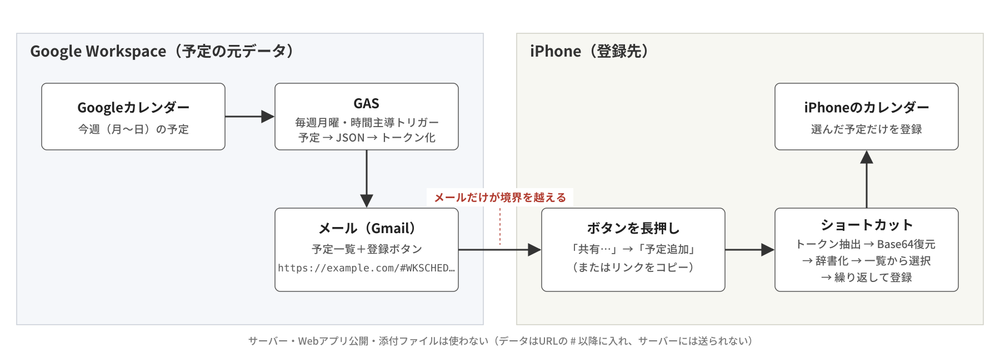

# gas-schedule-to-iphone

Googleカレンダーの今週の予定を、毎週月曜の朝にメールで送り、iPhoneのショートカットで選んだ予定だけをiPhoneのカレンダーに一括登録する仕組みです。

カレンダーの共有や同期ができない環境でも、**メールが届きさえすれば片方向で予定を渡せる**ことを目的にしています。



## 特徴

- **サーバー不要**：Google Apps Script（GAS）とiPhone標準の「ショートカット」アプリだけで動きます
- **Webアプリの公開不要**：GASは時間主導トリガーでメールを送るだけです
- **添付ファイル不要**：予定データはメール内のリンク（URLの `#` 以降）に埋め込みます
- **選んで登録**：メールのボタンを長押し →「共有…」→ ショートカットで、一覧からチェックした予定だけを登録します

## 構成

```text
gas/
  WeeklySchedule.gs   本体（予定取得・メール送信・トリガー設定）
  Debug.gs            切り分け用のデバッグ関数（任意）
  appsscript.json     マニフェスト（タイムゾーン Asia/Tokyo）
shortcut/
  README.md           iPhoneショートカット「予定追加」の作り方
docs/figures/         図
```

## セットアップ

### GAS

1. [Apps Script](https://script.google.com/) で新しいプロジェクトを作成し、`gas/` の3ファイルを配置する
   （`appsscript.json` はエディタの「プロジェクトの設定」→「appsscript.json をエディタで表示」で表示されます）
2. `WeeklySchedule.gs` の `CONFIG` を編集する

   | 項目 | 内容 |
   |---|---|
   | `CALENDAR_ID` | 取得元カレンダー（`primary` で既定のカレンダー） |
   | `TO_ADDRESS` | 送信先（iPhoneで受信するアドレス） |
   | `SEND_HOUR` | 送信時刻（この時台のどこかで実行） |
   | `SHORTCUT_NAME` | メールの案内文に表示するショートカット名 |

3. `sendTestMail` を実行してテストメールを確認する（初回は権限の承認があります）
4. `setupTrigger` を1回実行すると、毎週月曜に `sendWeeklySchedule` が動きます

### iPhone

[shortcut/README.md](shortcut/README.md) の手順でショートカット「予定追加」を作成します。

### 使い方

1. 月曜の朝に届くメールの「iPhoneに登録」ボタンを**長押し**
2. 「共有…」→「予定追加」
3. 一覧で登録したい予定にチェックを入れて「完了」

「リンクをコピー」してからショートカットを直接実行しても動きます。

## 登録データの形式

メールのボタンのリンクは `https://example.com/#WKSCHED<トークン>` です。トークンは次の手順で作っています。

```text
JSON → UTF-8 → Base64 → "+" を "_p"、"/" を "_s" に置換 → 先頭に "WKSCHED"
```

- `#` 以降（フラグメント）はブラウザがサーバーへ送らないため、誤ってタップしても予定の中身は外部に送られません
- 英数字と `_` だけにしているので、URLエンコードやGmailのリダイレクトURLに包まれても変化しません
- Base64の `=` が出ないよう、JSONの末尾に空白を足してバイト数を3の倍数にしています

元のJSON：

```json
{
  "labels": ["01 10/20(火) 10:00 定例"],
  "events": {
    "01 10/20(火) 10:00 定例": {"t": "定例", "s": "2026/10/20 10:00", "e": "2026/10/20 11:00", "a": 0, "l": "会議室"}
  }
}
```

| キー | 内容 |
|---|---|
| `labels` | 選択画面に出す表示名（並び順を保つため配列） |
| `events` | 表示名 → 予定データ |
| `t` / `l` | タイトル / 場所 |
| `s` / `e` | 開始 / 終了（`yyyy/MM/dd HH:mm`。終日は `yyyy/MM/dd` で、`e` はその日を含む最終日） |
| `a` | 1 = 終日、0 = 時刻指定 |

## 既知の制約

- 送るのはタイトル・日時・終日・場所のみです（説明・参加者・通知・繰り返し設定は送りません）
- 繰り返し予定は、その週の各回が単発の予定として登録されます
- 同じ予定を2回登録すると重複します（重複チェックはしていません）
- `COPY_LINK_BASE` は `https://example.com/#` にしています。タップすると example.com のページが開きます（データは送られません）

## ライセンス

[MIT](LICENSE)
